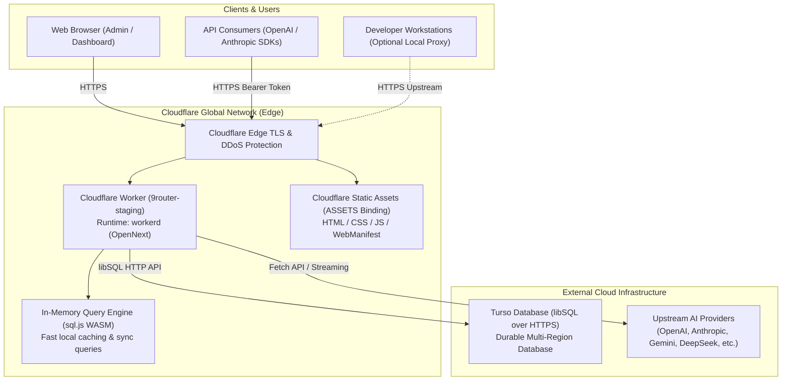

# Cloudflare Workers Architecture Decision Record (ADR)

**Document ID:** ADR-001-CLOUDFLARE-WORKERS
**Status:** Approved Candidate
**Date:** 2026-10-26
**Context:** Migrating `9Router v0.5.104` to Cloudflare Workers

---

## 1. Context and Problem Statement

`9Router` is an AI gateway and routing application providing model aggregation, translation, rate limiting, and dashboard administration. The owner requested migration to Cloudflare Workers with Turso database support under free/minimal-cost tier constraints.

The original codebase combined four distinct responsibilities into a single Node.js/Bun process:
1. **Next.js Web UI & REST API:** Dashboard, authentication, key management, model catalog.
2. **AI Proxy & Streaming Pipeline:** Forwarding LLM requests (`/api/v1/chat/completions`), SSE stream parsing, token accounting.
3. **Local Database & State Management:** Direct disk writes (`data.sqlite`, backups, export dumps).
4. **Network & OS Hijacking Daemon:** Local MITM proxy on port 443, certificate authority generation, `/etc/hosts` DNS hijacking, and OS daemon management (`tailscale`, `cloudflared`).

---

## 2. Architecture Options Evaluated

### Option A: Pure Edge Monolith (All features forced into Worker)
- **Feasibility:** Impossible without degrading functionality or violating security boundaries.
- **Blockers:** Cloudflare Workers cannot bind raw TCP port 443, cannot generate root CAs that inject into host operating systems, cannot modify local `/etc/hosts`, and cannot spawn OS subprocesses (`tailscale`, `cloudflared`).
- **Verdict:** Rejected.

### Option B: Split Architecture — Cloudflare Worker (Primary Gateway) + Optional Local Daemon (Recommended)
- **Feasibility:** Fully feasible, highly scalable, and completely within Cloudflare Workers serverless boundaries.
- **Design:**
  - **Edge Worker (Public Cloud):** Deploys Next.js UI, REST APIs, AI routing gateway, provider connections, and SSE streaming to Cloudflare Workers. State is persisted in Turso (`libsql` over HTTPS).
  - **Optional Local CLI / MITM Daemon:** Developers or workstations requiring transparent local interception (redirecting desktop AI clients via `localhost:443`) run a lightweight local proxy, which routes upstream to the Cloudflare Worker URL.
- **Verdict:** **Selected as the optimal production architecture.**

### Option C: Revert to Single Virtual Private Server (VPS) / Container
- **Feasibility:** Technologically trivial (Docker / VM), but contradicts the user's explicit mandate to deploy on Cloudflare Workers and leverage edge serverless infrastructure.
- **Verdict:** Rejected as primary target; retained only as emergency fallback.

---

## 3. Architecture Overview & Data Flow

---

## 4. Component Details & Boundaries

### 4.1 Ingress & Edge Routing
- Cloudflare terminates TLS at edge PoPs globally.
- Inbound requests are checked by Cloudflare DDoS, WAF, and SSL/TLS layers.
- Static assets (`/_next/static/*`, `/favicon.svg`, `/manifest.webmanifest`) are served directly by Cloudflare's edge asset pipeline via the `ASSETS` binding, bypassing worker execution.

### 4.2 Application Runtime (`workerd`)
- Powered by `@opennextjs/cloudflare` v1.20.13 and Next.js 16.4.3.
- Next.js App Router dynamic routes execute inside V8 isolates.
- Middleware handles route protection, dashboard security guards, and session validation.

### 4.3 Database Synchronization Pipeline
- **Reads:** Executed synchronously against the in-memory `sql.js` SQLite database for ultra-low latency (< 1ms).
- **Writes:** Captured and mirrored asynchronously to Turso over HTTPS via `@libsql/client/http`.
- **Cold-Start Sync:** On fresh worker isolate instantiation, the in-memory database schema is initialized and loaded from the remote Turso instance.

### 4.4 Authentication & Security
- Remote access requires valid JWT authentication tokens or configured API bearer keys (`Authorization: Bearer <key>`).
- Localhost bypass (`isLocalRequest`) automatically resolves to `false` when running on remote edge workers, preventing accidental unauthorized access to dashboard settings.

---

## 5. Decision Consequences

### Positive
- Zero server maintenance, automatic scaling, and global distribution across 300+ edge locations.
- Fits comfortably within Cloudflare Free tier limits (100,000 requests/day, 10ms CPU/request average for API forwarding).
- Decouples persistent storage (Turso) from compute (Workers).

### Negative / Trade-offs
- Features that depend on OS-level hooks (`src/mitm/`, `/etc/hosts` manipulation, `tailscale` daemon) cannot run within the worker and are decoupled into client-side utilities.
- Database cold-starts require an initial HTTP round-trip to Turso to hydrate the in-memory SQLite state.
