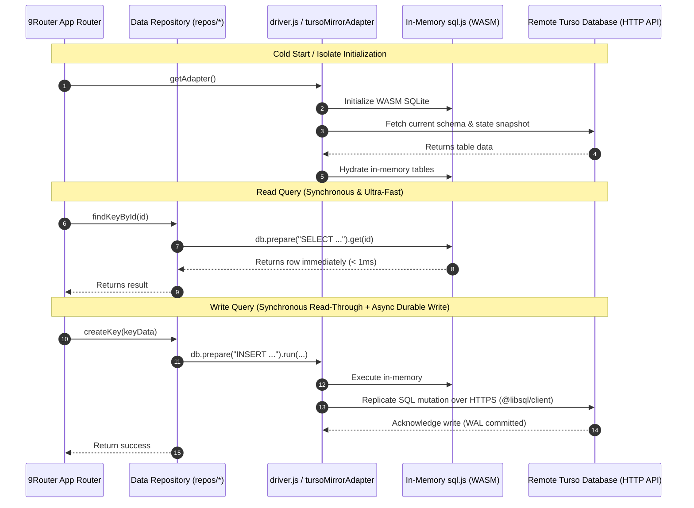

# Turso Database Integration & Durability Guide

**Target Application:** `9Router v0.5.104`
**Database Driver:** `@libsql/client/http` v0.17.0+
**Architecture:** Synchronous In-Memory SQLite (`sql.js`) + Asynchronous Turso HTTP Mirror

---

## 1. Overview and Rationale

Traditional Next.js applications running on full Node.js servers utilize native synchronous SQLite bindings (such as `better-sqlite3`). The internal architecture of `9Router` repositories (`src/lib/db/repos/*`) relies on synchronous execution patterns:

```javascript
// Existing synchronous pattern throughout 9Router repositories:
const stmt = db.prepare("SELECT * FROM keys WHERE id = ?");
const row = stmt.get(id);
```

Cloudflare Workers isolates run in a WebAssembly/V8 sandbox where:
1. Native C++ Node.js addons (`better-sqlite3`) cannot compile or execute.
2. The filesystem is virtualized and cannot persist modifications across isolate teardowns.
3. Network access to remote databases must occur asynchronously via the Fetch API or WebSockets.

To reconcile these constraints without rewriting hundreds of repository queries, `9Router` uses a **Mirror Adapter Architecture**:
- **Execution Engine:** `sql.js` (WebAssembly SQLite) loaded entirely into isolate memory. Repositories continue executing synchronous `.all()`, `.get()`, and `.run()` queries with zero latency penalty.
- **Durable Persistence:** All schema migrations and state mutations are replicated to Turso over HTTPS using `@libsql/client/http`.

---

## 2. Component Architecture



---

## 3. Configuration & Environment Variables

To connect `9Router` to Turso, configure these environment variables:

| Variable | Description | Example / Format | Secret? |
| :--- | :--- | :--- | :--- |
| `TURSO_DATABASE_URL` | The HTTP/HTTPS connection URL for your Turso database | `libsql://your-db-org.turso.io` or `https://...` | No |
| `TURSO_AUTH_TOKEN` | Read/write authentication token generated via Turso CLI | `eyJhbGciOi...` | **YES** |
| `TURSO_SYNC_INTERVAL_MS` | (Optional) Background polling interval in ms (default: `10000`) | `10000` | No |

---

## 4. Cold-Start Initialization & Schema Migration

1. **Initial Connection Check:**
   During cold starts, `driver.js` initializes the Turso client. The `/api/health` endpoint verifies connectivity.
   - If Turso is unreachable or credentials are unset, `/api/health?probe=liveness` still returns HTTP 200 (worker is running), while full readiness returns HTTP 503 until the database handshake completes.
2. **Schema Migration:**
   `src/lib/db/migrate.js` contains versioned schema migrations (`#1 initial`, `#2 ...`).
   Migrations run automatically on first start against both the in-memory schema and the remote Turso instance.
3. **Data Hydration:**
   The initial state of users, keys, providers, and settings is loaded into memory so that subsequent requests hit memory directly.

---

## 5. Durability & Failure Modes

| Scenario | Behavior | Mitigation |
| :--- | :--- | :--- |
| **Isolate Eviction (Cold Start)** | The in-memory `sql.js` state is discarded. Next request spins up a new isolate. | Fresh isolate re-hydrates state from Turso on startup. |
| **Turso Network Glitch** | Read operations continue from in-memory cache. Pending writes retry with exponential backoff. | `@libsql/client` handles transient network reconnects. |
| **Write Conflict** | Two simultaneous isolates write to the same row. | Turso enforces ACID transactional locks at the cloud database level. |
| **Local File Writes** | Filesystem operations (`fs.writeFileSync`) in legacy backup scripts throw `EPERM`/`ENOSYS`. | Guarded with non-fatal try-catch blocks. Backups are preserved via Turso cloud snapshots. |

---

## 6. Verification & Health Monitoring

Verify Turso integration locally or on staging using:

```bash
# 1. Test database fallback chain in unit tests
npm test -- unit/db-driver-chain.test.js

# 2. Check live worker health
curl -s http://127.0.0.1:8787/api/health
# Expected Response: {"ok":true,"db":"connected","turso":true}
```
